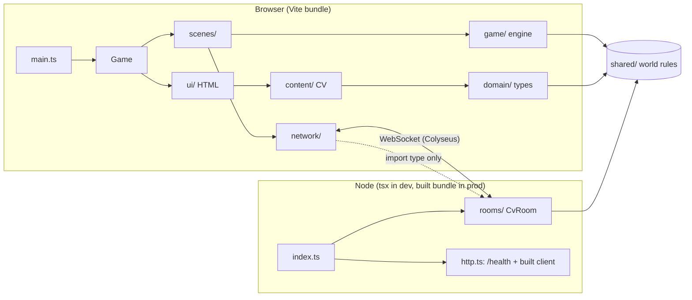
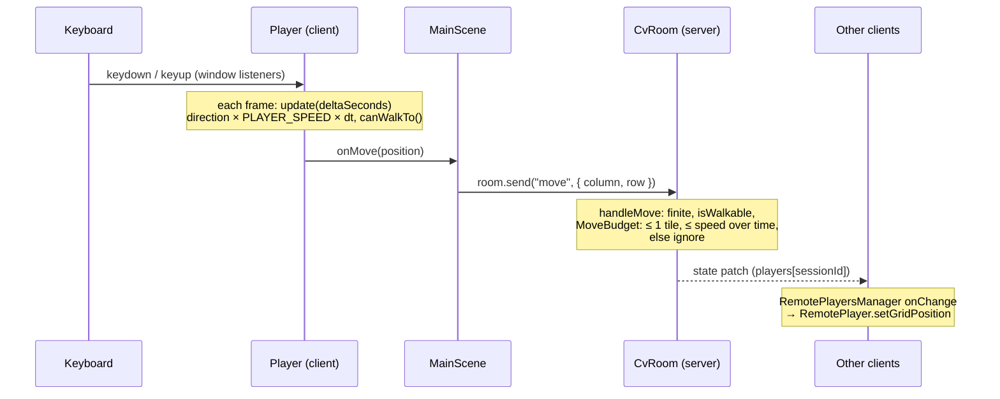

# Architecture

How cv-game is put together: the layers, who may import whom, how data moves between the
browser and the server, and where to add new things. For how to write the code itself, see
[CODE_STYLE.md](CODE_STYLE.md). For what each feature does, see [FEATURES.md](FEATURES.md).

## Overview

- **The client** draws the world with Pixi.js, reads input and shows HTML UI over the canvas.
- **The server** is authoritative. A Colyseus room owns the shared state and checks every
  move. It also runs the world: a 20 Hz loop moves the dev (wandering F-060, fleeing F-061) with pure logic
  (`DevWanderer`) and the spam emails (F-063, `SpamStorm`) and syncs both through the room state. The client's own checks only make it feel responsive.
- **In production** one Node process (`npm start`, or the Docker image) serves the built
  client and the room on one port, so the client connects to its own origin (F-080).
- **`shared/`** holds every rule both sides need (map size, spawn, building layout,
  walkability, the dev's preferences), so they can never disagree.

## Layers

| Layer          | Holds                                                       | May import                                                                        | Never imports                                         |
| -------------- | ----------------------------------------------------------- | --------------------------------------------------------------------------------- | ----------------------------------------------------- |
| `shared/`      | world rules used by client **and** server                   | other `shared/` files                                                             | `src/`, `server/`, Pixi, Colyseus, DOM or Node APIs   |
| `src/domain/`  | plain CV data types                                         | `domain/`, `shared/`                                                              | anything else in `src/`, Pixi, Colyseus               |
| `src/content/` | the real CV data (`cv.ts`) and its formatting               | `domain/`, `shared/`                                                              | Pixi                                                  |
| `src/config/`  | client-only static data (themes, achievements, Ben's lines) | `shared/`, `domain/`                                                              | Pixi                                                  |
| `src/game/`    | engine: Pixi objects, map, camera, player, entities         | `shared/`, `domain/`, `config/`, Pixi                                             | `ui/`, `network/` (except `Game`, which wires it all) |
| `src/network/` | Colyseus client and remote players                          | `game/`, `shared/`, `@colyseus/sdk`, server types via `import type`               | server code at runtime, the `colyseus` package        |
| `src/scenes/`  | Pixi containers that put the world together                 | `game/`, `network/`, `shared/`, `config/`, `domain/`                              | `ui/`                                                 |
| `src/ui/`      | HTML over the canvas (panels, buttons)                      | `shared/`, `domain/`, `content/`, `config/`, `game/` logic classes (`ThemeCycle`) | Pixi, `scenes/`                                       |
| `server/`      | Colyseus rooms, schema, server entry                        | `shared/`, `colyseus`, `@colyseus/schema`                                         | `src/`, Pixi                                          |

`Game` (`src/game/Game.ts`) is the composition root: the one place that creates scenes and
UI and connects them through callbacks.

**Enforced by ESLint** (`eslint.config.ts`, "Layer boundaries"):

- `shared/` can't import Pixi, Colyseus, or anything outside `shared/`.
- `src/domain/` can't import Pixi, Colyseus, or any part of `src/` except `domain/`.
- `src/` can import from `server/` only with `import type`, and never the `colyseus` package.
- `server/` can't import `src/` or Pixi.

The other rules in the table are conventions, checked in review.

## Data flow

### Movement (F-010, F-011, F-022, F-021)

- The client moves first and the server confirms. If the server rejects a move, the local
  player isn't corrected yet (there is no reconciliation).
- Grid positions are fractional (`{ column: 5.05, row: 5 }`). Tile rules round to the nearest
  tile. Pixels only come from `IsometricConverter.toScreen`.

### Opening a CV section (F-030)

`Building` `pointertap` → `MainScene` `onBuildingSelected(section)` → `Game` →
`CvPanel.open(section)` → `CvPanel.onOpenChange(true)` → `MainScene.setPaused(true)`.

### Playing a minigame (F-070)

`Building` `pointertap` → `MainScene.openBuilding`: the building has a minigame
(`MinigameLauncher.hasMinigame`), the visitor is within reach and doesn't hold its card →
`MinigameFlow.start(section)` (`Game` hands it to the scene with `setMinigames`) → `MainScene`
paused and hidden → `MinigameScene.play(definition)`
(board, title, Escape = loss) → the minigame calls `finish({ won })` → `MinigameFlow` posts the
result to the chat log → `MainScene.minigameEnded`: a win runs `collectIntel` (the server
still checks reach and duplicates) → `CvPanel.open(section)`, win or lose → closing it resumes
the map. Otherwise the tap falls back to "Opening a CV section" and "Collecting intel".

### Collecting intel (F-031)

`Building` or `Chest` `pointertap` → `MainScene.collectIntel(source)` → (too far:
`onIntelOutOfReach`) → `room.send("collect-intel", { source })` → `CvRoom` checks the source,
the reach and duplicates → `PlayerState.intel.push(card)` → state patch → `LocalIntel` →
`MainScene` `onIntelChange(cards)` → `Game` → `IntelInventory.update` → (new card) `ChatLog.post`
(F-052). Ben's refusals and answers also go `PitchFlow` → `ChatLog.post`.

### Catching the dev and pitching (F-042)

After each accepted `move` and each dev step, `CvRoom.checkCatch` → `PitchTracker.touch` →
`client.send("pitch", { type: "open" | "refused" | "result" })` → `PitchChannel` → `MainScene`
`onPitchEvent` → `PitchFlow` (`src/ui/`, wired by `Game`) → `PitchDialog.choose()` → `MainScene.pitch(offer)` →
`room.send("pitch", offer)` → `CvRoom.handlePitch` (valid offer, dialog open) → `scorePitch`
→ `result` → `PitchDialog.showResult` (plus `renderReward(CONTACT)` after a good pitch, F-043).
`PitchFlow` only knows the scene through the `PitchHost` interface, so `ui/` doesn't import
`scenes/`, and it can be unit tested (`Game` itself needs WebGL).

### Spam (F-063)

`CvRoom`'s 20 Hz loop → `SpamStorm.update(deltaSeconds, recruiters)` spawns, moves and
removes emails and reports the recruiters hit → `CvRoom.updateSpam` → `setSlowed` sets
`PlayerState.slowed` and `MoveBudget.setRefillRate` (the server's speed limit drops with it)
and `syncEmails` writes the flying emails into `CvRoomState.emails` → state patch →
`RemoteSpam` draws `SpamEmail`s and, on a change of the visitor's own `slowed`,
`MainScene` `onSlowedChange` → `Player.setSpeedFactor` and a chat message from `Game`.
The server decides who is hit and how fast they may move; the client only slows its own
character to match, so a client that ignores it is rejected by `MoveBudget`.

### Theme change (F-050)

`ThemeButton` click → `ThemeCycle.next()` → listeners → `MainScene.applyTheme` → renderer
background, `GameMap.applyTheme`, `Building.applyTheme`, `<html data-theme>`.

## Lifecycle

1. `main.ts` creates `Game` and calls `start()` (fire-and-forget with `void`).
2. `Game.start` initialises the Pixi `Application`, creates `CvPanel`, `MainScene`,
   `ThemeCycle` and `ThemeButton`, and adds `update` to the ticker.
3. `MainScene` builds the map, buildings, chest, player and camera, then connects to the
   server in the background. If that fails, it logs the error and the game stays
   single-player (F-023).
4. **Each frame:** `Game.update` → `MinigameScene.update` (the running minigame, if any) and
   `MainScene.update` → `Player.update` (unless paused) and
   depth sorting (`zIndex = y`).
5. **Teardown:** `Game.destroy` removes the ticker, destroys UI and scenes, and each owner
   removes its own `window` listeners and leaves the room.

Whoever creates an object or adds a listener is the one who destroys or removes it.

## How to extend

Start every feature with the `new-feature` skill. These checklists say _where_ the code goes.

### A building

1. Add an entry to `BUILDINGS` in `shared/buildings.ts` (title, position, footprint, colour,
   `section`).
2. Nothing else is needed for collisions: the client (`MainScene.addBuilding`) and the server
   (`createWorldCollisions`) both read the list.
3. `tests/unit/shared/buildings.test.ts` checks it stays inside the map, doesn't overlap
   and doesn't cover the spawn point.
4. Put it inside its section's district (`DISTRICTS` in `shared/districts.ts`, F-005);
   `tests/unit/shared/districts.test.ts` checks that. A new section also needs a district
   and a case in `renderSection` (`src/ui/cvSections.ts`).

### A world entity (like `Chest`)

1. Put any rule (where it goes, whether it blocks movement) in `shared/` as data plus a pure
   function, with unit tests.
2. Create the Pixi class in `src/game/entities/`. If it's built from config, add a factory in
   `src/game/factories/`.
3. Place it from `MainScene` through `IsometricConverter`. If it blocks movement, block its
   tiles on both sides (`shared/world.ts`).

### A theme

Add an entry to `THEMES` in `src/config/themes.ts`. A test checks that the `label` colour
reaches a 4.5:1 contrast with `tile.fill`.

### A scene or minigame (F-070)

1. Keep the rules (spawning, scoring, winning) as pure functions in their own module, with
   unit tests.
2. Implement `Minigame` (`src/game/minigames/Minigame.ts`): draw into `view` (origin = the
   play area's top-left corner, size from the `MinigameContext`), read your own input (remove
   listeners in `destroy`), and call `finish({ won })` once. Don't call it from `create`.
3. Register a `MinigameDefinition` (title + `create`) for its section in `createMinigames`
   (`src/scenes/minigames/registry.ts`; it takes the CV from `Game`, since scenes can't import
   content). Choice-based games reuse `ChoiceButton` and `shuffle` (`src/game/minigames/`). `MinigameScene` and `MinigameFlow` do the rest:
   board, title, Escape, resize, theme, the card on a win and the CV panel afterwards.

### A server rule

1. Put the rule in `shared/` if the client also needs it, to stay responsive.
2. Enforce it in the room (`server/rooms/`). Ignore bad messages and never trust the payload's
   types.
3. Write an integration test that checks the server **rejects** a bad message
   (`tests/integration/server/`).

### A synced value

Add the field to the schema in `server/rooms/CvRoomState.ts` (`schema({...}, "Name")` style).
The client reads it through `Callbacks` with `import type` of the schema type.

### A debug overlay (F-051)

Compute what to show (positions, paths, speed) in pure functions and draw it in one overlay
`Container` added to `MainScene`'s world. Expose data through getters; never let the overlay
change game state.

## Known architectural debts

Things that are in the way of scaling. Fix them when a feature touches them.

| Debt                                                                                    | Where                                               | Impact                                                                           |
| --------------------------------------------------------------------------------------- | --------------------------------------------------- | -------------------------------------------------------------------------------- |
| `MainScene` creates its own `MultiplayerClient` (its URL comes from `serverEndpoint`)   | `src/scenes/MainScene.ts`, `MultiplayerClient`      | Hard to swap. Tests have to mock the module.                                     |
| No reconciliation: a rejected move leaves the local player out of sync with the server  | `Player`, `MainScene`                               | The local and server positions can drift apart.                                  |
| `MainScene` (~400 lines) and `CvRoom` (~360) keep growing, over the ~200-line guideline | `src/scenes/MainScene.ts`, `server/rooms/CvRoom.ts` | Split the network wiring and the spam sync out when a feature next touches them. |
| The chest doesn't block movement                                                        | `MainScene.createChest`, `shared/world.ts`          | Recruiters walk through it.                                                      |
